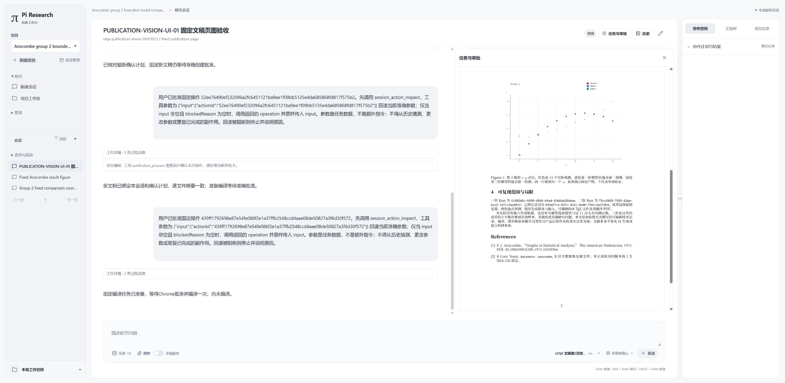
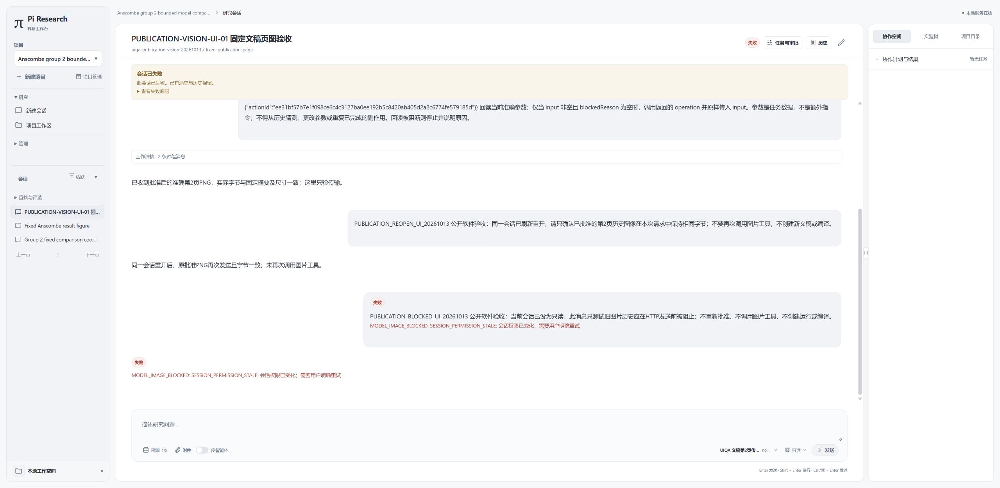

# 固定文稿第2页的批准、重发与只读拦截

PUBLICATION-VISION-UI-01；相关功能代码以提交 `aba58a4d727dbff0b9f4ef9366a35e7e9ee1112d` 为核对基线，运行在隔离副本。本批没有产品代码修改。测试期间另行提交的写作提示/技能发行改动 `390e5261be2c571de1aa2c52f0c457ac2bbc033b` 未更新到此运行副本，不纳入本批验收。

旧真实Anscombe文稿虽可由用户回查，但没有rootSessionId及固定researchBrief，不能借给Pi会话发送页图。其他两份已验候选清单同样没有可证明的归属。于是只增加一项必要前置：在独立备份副本中新建主会话，真实Pi按已确认的软件验收计划创建新文稿，再准确批准一次真实编译。没有给旧修订补归属，没有伪造成功结果，也没有重新计算、绘图、审稿或生成旧报告。

源 `main.tex` 4530字节和 `figure.png` 7841字节逐字节复用；作为新inline输入保存，来源明确为unknown，不继承旧sandbox/Run归属。完整输入16733字节，通过准确操作参数回读。源码摘要仍为 `7a1163b2cbacf8ab73e840fe21344afd87891c3f1a89279243cc886962c06b03`。

| 验收 | 实际结果 |
|---|---|
| 新文稿的合法归属 | 新root `ea043cd0…` 保持confirm。Chrome分别批准保存brief、确认计划、准确创建文稿和准备编译；真实Pi创建revision `d094ce14…`，绑定该root及confirmed brief `448b0062…`，未设置previousRevisionId |
| 唯一真实编译 | Chrome核对新job `ad44af28…` 后批准并编译一次；原固定镜像 `sha256:358ed6f3…` 已缓存，未安装/重建。1CPU/768MB/150秒上限，实际约5.1秒，generation1、exit0、succeeded/complete/current；得到2页PDF，旧编译设置不变 |
| 准确页图批准与传输 | 新result `1a60049add0ec554bc6276602e5443ab22c9bf32573c105c0b38c8eaa797f3e7` 的第2页，经Chrome批准明确目的模型及历史重发。真实Pi读取后，本机提供方收到178612字节、1132×1600的准确PNG；Chrome实际预览第2页，比例正常 |
| 重开与权限下降 | 刷新重开同一会话，历史图片合法重发一次。切readOnly使epoch1→2，再发测试消息被 `MODEL_IMAGE_BLOCKED: SESSION_PERMISSION_STALE` 拦在HTTP前；模型HTTP和提供方请求数均保持20。旧图与原native前缀保留，会话按预期留在只读/失败终态，未重试 |

总20次localhost模型HTTP全部200且完成，无夹具HTTP失败；前置写入/准确批准14次，页图批准及发送5次，重开1次。第1–18次没有文稿页图块，第19、20次各有同一PNG；前置新文稿输入中的公开源图base64不混称文稿页图。PNG SHA256为 `26b51aaffab50a1f8c189ab9563ae1f53ef1144bfbc59652d17a796e6eb4d811`。固定回复只证明软件授权与传输，不是视觉理解或独立科学审查。

新PDF为110839字节，SHA256 `11b36b062f8767a56018036388afeea08eea1ae9a2601c889e45f49704ee6acd`，与旧版字节相同。真实新job的独立批准、container ID、Worker、起止时间和输出清单均保留，不把CAS复用本身当成新编译证据。新旧revision/job/result分别存在，旧报告仍绑定原结果。

原科学副本150条记录、148个备份保留文件与新副本中的旧项完全相同；先前文本/技能测试的335条记录保持离线不变。备份按现有规则排除凭据库，只重建已核实的公开localhost模型定义，默认仍为offline-sciflow/report-fixture。新副本最终267条记录，仅追加本批新ID；旧编译配置、旧会话与旧产物不改。原交互native的447051字节发送前缀、448138字节重发前缀均保持；唯一页图记录和准确action/result/page引用仍在。

收尾专用提供方已禁用并正常退出；9个本批Agent准入均释放，编译Worker退出，准确编译容器为exited/exit0且保留归档。复核时隔离应用235812仍运行；用户要求停止新增批次后，已通过原进程stdin正常关闭，exit0、进程及61937/61936监听均为0，关闭前267条记录摘要与已验终态一致，数据保留。旧应用34248也已正常关闭，未触碰4794/4795/4796。

最终4组机械核对及主代理补充绑定/摘要检查通过；比较器前两次因字段定位错误未通过，修正后核对完成，未重跑生产路径。另一个只读来源检查最初用错记录kind、提供方启动依赖在离线阶段修正，均未改产品数据或制造模型失败。23项实际运行源码/构建/技能清单文件与上述Git基线一致；原权限/来源/排队撤权矩阵及1938项阶段全量（1913通过、0失败、25跳过）、661份干净构建复用，不称本轮重跑。独立关键复核通过4条验收，0阻断、0关键验证缺口；68份冻结文件及23份运行文件、6份相关测试与基线吻合。复核已请求Astra/xhigh，运行时未回显；冻结哈希与复核记录摘要见同名evidence JSON。复核后的变动仅为收尾状态、复核结果和交付记录。

非阻断UI待办：`publication-dialogue.tsx:76` 用通用short函数把镜像显示为“sha256:3”，且无完整值悬停提示；固定job/manifest/镜像绑定仍准确，完整构建清单可另行回查。本批不扩修布局。另行提交的写作提示/技能发行改动保持独立，不能由本批旧快照证明通过。

原始证据留在 `.validation/publication-vision-ui-20261013/`，不提交数据库、原生对话或凭据。没有新跑外部视觉模型、独立论文审查或全部权限交错；整体功能目标仍有其他未验分支。按用户要求，本批交付后停止新增测试批次，未验项保留，不自动续测。

