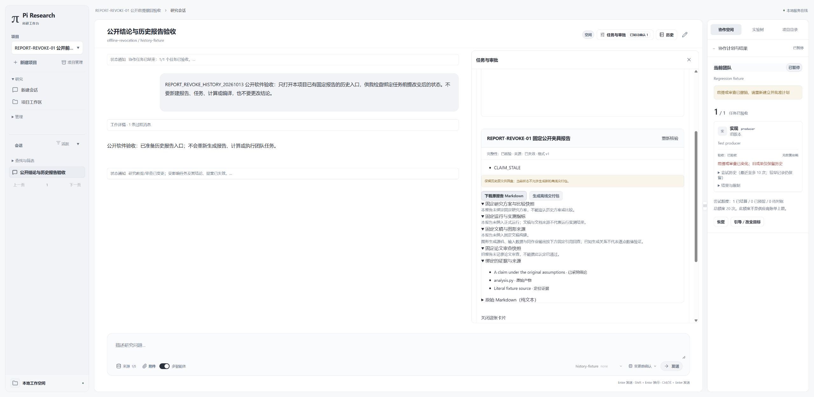

# 报告前提撤回与历史保留

REPORT-REVOCATION-UI-01；代码基线 `cd1e1eb387548a05f993e1e0dd27380b8f40559e`。通过现有Chrome“引导 / 改变目标”撤回公开单任务夹具的前提，补 `evidence/report-export-revocation` 的任务/结论分支。没有修改产品代码、增加入口、重跑全量或干净构建。

| 验收 | 实际结果 |
|---|---|
| 有效的固定来源基线 | 复用现有 `acceptedSource(s,false)` 辅助函数建立一个已完成团队、一个已采纳任务/结论，再用生产服务保存报告及旧包。都是公开软件夹具，无真实科研判断、计算或编译。真实Pi的两次本地固定HTTP回复只打开历史报告入口 |
| 精确撤回已有前提 | Chrome只提交一次revise指令 `ab8fc03b…`，覆盖新团队唯一任务 `7b24d3c9…`。原科学项目不具备这项任务前提，保持离线，不用项目归档替代 |
| 新成果阻断 | 页面自动显示“完整性：已核验 · 来源：已失效”，新离线包按钮禁用。单独的当前夹具后端检查以新请求键调用，导出返回409 `REPORT_STALE`，新报告返回409 `CLAIM_STALE`，未发布新记录 |
| 历史、重开与无关数据 | Chrome仍能读取生成时的固定结论与正文；刷新重开后失效状态保留，下载原Markdown1147字节与原摘要完全相同。旧包3710字节通过原产物HTTP只读读取核验，原文件未改；无关控制项目与旧科学数据保持 |

报告ID `69b1e4c8-a57a-480e-849c-b1733d37a191`。原正文SHA256 `f3e99fe9aea1970d05e7939a50fc03254280a475dda6d0239c57f3f437e91309`；旧包SHA256 `6664aaa7e1075106ebecb447cc0f99d4305d7d5ab90225cfd0af269cd19d596c`。历史引用中的 `validity: current` 是生成时的固定内容，报告上方当前核验已明确失效；没有重写历史来伪装新结论。

撤回前后38条初始记录中的32条不变；仅任务、团队、结论、采纳记录、批准与结果通知的6条元数据按既有失效规则变化，新增1条指令和1条系统通知。原任务结果、尝试、证据、报告及导出记录保留；无关控制项目2条记录、旧科学副本150条业务记录精确相同。没有新增模型调用、Run、编译或GitHub外联。

复用上一阶段1938项检查中的报告前提撤回、历史引用、失效导出和并发核验结果，以及干净构建的661个产物文件一致。当前代码与运行副本的相关文件仅允许换行差异，摘要见 [机器证据](2026-10-13-report-premise-revocation.evidence.json)。独立Astra/xhigh关键复核完成，四项验收有证据支持，无阻断；请求模型和档位的运行时未回显。

非阻断待办：报告重开没有旧离线包历史列表，本批仅证明旧包原字节及产物读取保留，不冒称通过UI重新找到旧包；旧任务失效后右栏仍写“1/1任务已验收”，同时另有“旧版本”和历史警告，可进一步区分历史验收与当前有效性。本批不扩修布局或增加功能。

工具与夹具限制：下载事件等待超时，但唯一点击后新增本机文件的时间、大小和摘要已经核实，未再次点击。初次夹具准备错误地把任务终态写成`succeeded`，实际为`output_submitted`且已验收；进程在监听端口前退出。修正为核对提交、验收、尝试完成和团队完成四个字段后，从原已建立记录续接，没有删库或重复建立任务。这不是产品缺陷。

只验团队前提撤回导致Claim失效的分支；RunGrant、WorkingGrant、DiscoveryGrant、文档解析批准等其他撤销路径不据此全部记通过。后端存在RunGrant撤销组件但当前页面未挂载，TextCorpusGrant撤销主要控制读取权限，也不等于撤销报告科学来源。原73流程总目标仍未完成。

