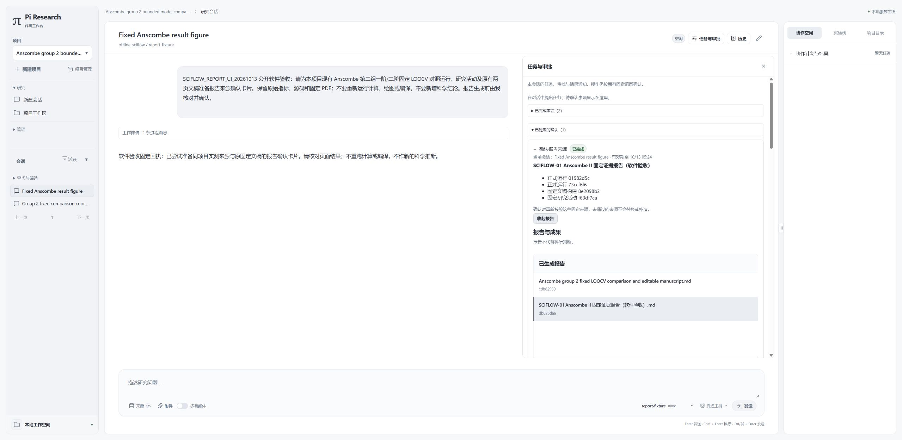
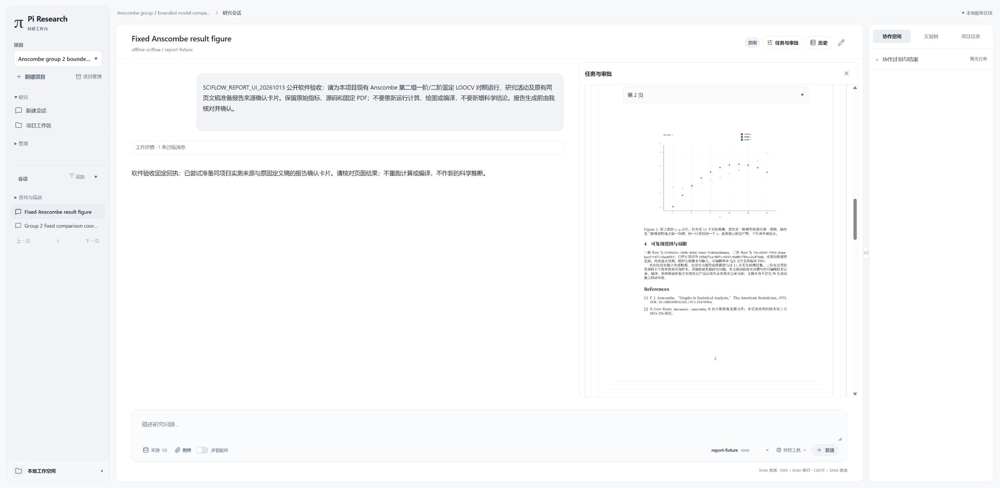

# 当前主会话中的科研证据与文稿交付链

SCIENTIFIC-FLOW-UI-01；代码基线 `63c063bf5aa0a51461e96b329df1bcb43ca56f59`。按用户精简要求，复用同项目已经真实完成的 Anscombe 对照计算、绘图及编译，只补当前 Pi/Chrome 的固定来源确认、报告、回查和离线交付。没有重新计算或编译，没有把固定回复当作科学推断，也没有改产品代码或布局。

公开问题限定为 Anscombe 第2组的11个观测：相同留一规则下，二阶模型的MSE是否不高于一阶的90%。旧真实运行、源码、数据与编译实物在当前产品重新核验后仍适用；不把其他项目的实物拼入本链。

| 环节 | 实际证据 |
|---|---|
| 固定研究问题与真实运行 | 同项目 `35657bab…`、活动 `f63df7ca…`；Run `01982d5c…` 与 `73ccf6f6…` 都是 succeeded/complete，指标与不可变原始产物相符。LOOCV MSE分别为2.204181036321706与0.0000031116060756864716 |
| 既有真实文稿编译 | 原修订 `597c6c41…`、构建 `8bb10f68…`、结果 `8e2098b3…` 当前来源有效。现有固定Docker镜像与当前脚本/依赖配置匹配；原2页PDF摘要未变，无需重建镜像或重编译 |
| 当前Pi准备、Chrome确认 | 一条公开人工消息经真实Pi、两次本地固定HTTP回复，仅准备来源卡片。确认前报告数不变；Chrome点击后，请求 `edcebff2…` 从pending变为completed并绑定新报告 |
| 新固定报告与精确回查 | 报告 `db825daa-60f4-4a83-beb2-79530d44db0a` 完整性已核验、来源当前有效；Chrome回查一阶原始指标、固定问题/成功与停止条件、原TeX、同一构建及PDF页图 |
| 下载及交付 | PDF实际新增下载110839字节，摘要与原构建一致。离线包实际下载736586字节；38条目、36文件全部大小/摘要匹配，35个原科学文件与旧交付完全相同，仅新报告正文变化 |

新报告正文见 [report.md](2026-10-13-scientific-flow/report.md)。PDF复用既有实物，SHA256 `11b36b062f8767a56018036388afeea08eea1ae9a2601c889e45f49704ee6acd`。新离线包SHA256 `9caf3ee0bc17ba33651cfb2ed70e506bda06708a562a23f6605975561df053e5`；包内新报告SHA256 `fa882d0f92fdd28e5631e44bd008342758d04d7c12b5e1501ba0b829eb7680ca`。本仓库不重复提交旧PDF或包内35份实物。

报告与原文稿明确保留“需要研究者审阅”“未独立审查”和11点固定评估的限制，不外推泛化能力。本轮使用本机确定性模型回复驱动软件操作，不验证外部模型的科研推理或文稿创作质量。编译属于已通过且当前适用的历史真实路径，不称本轮新编译。

保留检查没有省略。原paper数据先确认空闲、旧节点及端口不存在，再通过现有备份流程准备独立副本；不是重做备份功能矩阵。schema10→14仅执行既有迁移：7个项目生命周期字段、迁移/协调结构、操作归属元数据等逐项核对；129个非project记录和20份旧操作回执原字段保持。145个保留文件原字节相同，原科学数据目录持续离线。

首次Store迁移后的比较器因Node SQLite返回对象的原型差异误报；只规范化比较对象的JS原型，保留全部字段/类型断言，再对已经完成的迁移做只读续检，没有再执行迁移。原失败记录与后续通过记录都保留。

Chrome“新建会话”按现有设计复用了无消息、generation0的空白协调会话 `6aeb156a…`，因此旧标题仍为“Fixed Anscombe result figure”。只在独立副本更新这个会话的模型/生成代次/原生历史；其余135份初始业务记录保持，旧Run、审批、源码、报告与文稿未改。另有14份新模型账目/消息/确认/报告及导出记录，类别逐项列明。先前3项目、10会话、99消息、318记录及项目文件摘要也保持，没有混入或覆盖这套科学副本。

刷新后页面回到首个项目；手动选回后同一会话、新报告及来源仍可读。导航不保留选择、复用空白会话时保留旧标题均记为非阻断体验待办，本批不扩修。两次下载的浏览器事件工具均超时，但点击后新增文件的时间、大小及摘要已独立核实，没有重复下载；未把事件超时计作产品下载失败。

证据维护说明：上一设置页夹具关闭时，`save(final)`与人工捕获文件同名，覆盖了此前raw `green-final.json`。此前哈希保留为历史记录；关闭快照与未变的`green-visible`等快照在全部业务字段及GitHub调用上相同，当前保留检查提供替代证明，不伪称恢复了丢失的旧raw快照。本批捕获与关闭文件采用不同名称。

本阶段集中全量1938项：1913通过、0失败、25跳过，退出码0；跳过项不记通过。干净安装、构建、类型检查通过，661份产物一致。独立Astra/xhigh关键复核完成，五项验收在上述复用范围内通过，无新增阻断；请求配置运行时未回显。冻结快照摘要与复核结论记录在 [evidence.json](2026-10-13-scientific-flow.evidence.json)。预检请求Sol/high，保留边界请求Astra/high；运行时未回显。原始证据保留 `.validation/scientific-flow-ui-20261013/`；全量原日志位于上一候选的 `.validation/settings-github-ui-20261013/result/phase-full-tests.log`，不复制日志，不提交数据库、原生对话或凭据。

这条复用既有实测与编译的完整交付链已连通；从零科研生成、独立论文审查及原73流程中其他未验分支不据此记为通过，整体功能巡检仍未完成。

