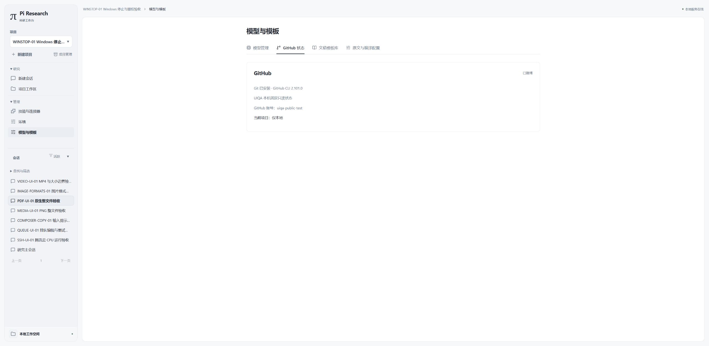

# GitHub 状态仅在可见设置分区查询

SETTINGS-GITHUB-VISIBILITY-01；基线 `2b65e8988d67785a7831a4ae45885e4b080ae0ca`。修复模型设置页挂载隐藏 GitHub 面板时自动检测账号的问题，不改变布局、后端同步或权限。

Chrome 修前只打开“模型管理”，已发出 `/github/status` 和当前项目 GitHub 状态两个 GET。修后同一核心场景：模型页0次；打开 GitHub 分区才发出两次；返回模型页不新增请求。账号显示来自本机公开固定客户端，不代表真实外部登录或 GitHub 建仓同步通过。夹具记录了全部相关 GET 及客户端调用，没有读真实凭据。

改动为 SettingsView 传递可见状态，GitHubSettings 在读取入口及轮询处检查该状态。组件继续挂载，模型/模板草稿、GitHub同步忙碌状态及幂等键保留；已发出的读取不会被假称取消，但其迟到结果不能启动隐藏轮询或覆盖新项目。返回可见分区后刷新当前状态。

四条验收：

1. 默认模型页和隐藏时不发起GitHub账号/项目读取；初始、焦点场景有行为回归。
2. 可见时正常读取；焦点与重开刷新、CLI状态失败后重开恢复由相关回归覆盖。
3. 隐藏停止新轮询，迟到回执不重启隐藏轮询，项目切换隔离不变；已提交同步在隐藏期间成功或失败仍能结束，忙碌与重试身份保留。
4. 组件和草稿继续保留，只读、版本和幂等限制不变。Chrome仅一个只读导航场景，3项目/10会话/99消息、全部业务记录及项目文件摘要不变；没有模型执行或远端写入。

原dist同一回归19项：14通过、5失败；修后19项全通过。主代理集成后相关四个suite共54项全通过，普通构建通过。按用户最新精简要求，不在此批重复全量或干净构建；留到阶段性交付，不把以前干净构建当作本候选已重跑。

环境记录：红夹具由非TTY启动，标准输入关闭，无法使用约定的stop命令；主代理先记录空闲状态、核对专用PID49920及无子进程，再只停止该进程，确认端口释放后启动绿夹具（TTY）。没有重启原数据目录或4794/4795/4796服务；后续完整业务摘要一致。此为测试启动方式问题，不计作产品缺陷。

现有项目状态GET成功不清共享错误字段的行为未扩修，以免吞掉同步失败反馈；后续按需单独处理。先前备份批次缺失的GitHub外联观测仍保持“未知”，本轮固定客户端测试不能反推旧观测。

独立Sol/high复核完成，四条验收可接纳，无新阻断；核对七文件、13个证据锚点与原始快照，未增加验证轮次。实现及复核均请求Sol/high，运行时未回显实际档位。原始证据保留在 `.validation/settings-github-ui-20261013/`；精简机器证据见 [evidence.json](2026-10-13-settings-github-visibility.evidence.json)。

