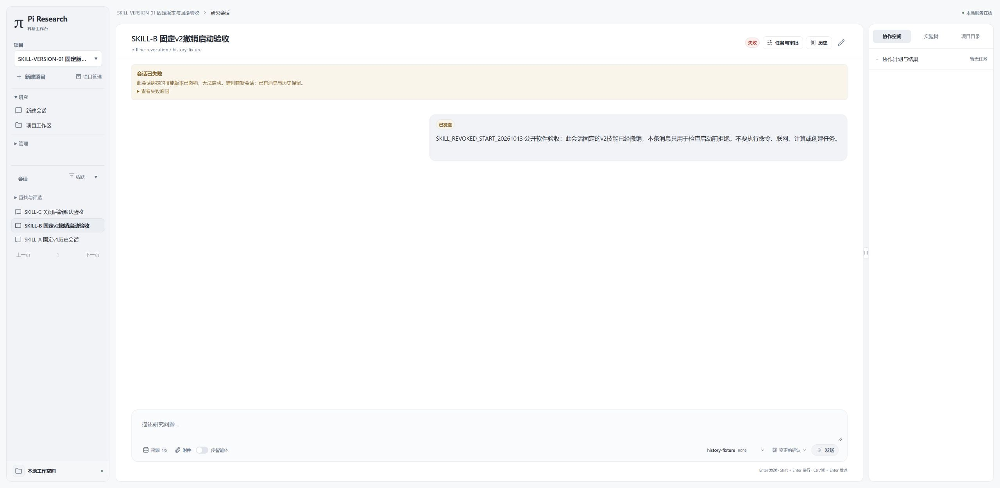

# 技能固定版本、回滚与撤销拦截

SKILL-REVISION-UI-01；基线 `ded2d95eb366713bf588769e430622b290804389`。补自定义技能固定绑定流程，并修复一次真实Chrome检查发现的失败原因缺失。测试只在新公开项目中进行；已有上传/UTF-8边界、任务重试及内置发行固定检查复用，不重跑科研任务或外部模型。

| 验收 | 实际结果 |
|---|---|
| 固定修订与资源 | 通过owner API准备v1/v2两个纯文本修订和notes.txt，无工具、后端、数据权限要求。Chrome读取两个精确修订、资源标记、许可证及SHA256，四个原文件摘要一致 |
| 升级保留旧绑定 | owner API将A显式绑定v1；Chrome开启v2后，再将B显式绑定v2。默认配置只含v2，A仍读v1，B读v2；不能用“创建过空会话”代替固定绑定证明 |
| 回滚及关闭 | Chrome重新开启v1完成回滚，刷新重开仍为v1开启/v2关闭；A/B保持各自固定包。关闭v1后，新C只有内置包，A/B旧绑定仍有效，说明关闭不等于撤销 |
| 撤销与启动边界 | owner API撤销v2后，Chrome的v2开关禁用；B预检ready=false、原资源仍可读，重新启用返回409 `SKILL_REVOKED`。Chrome只发送一次公开拦截消息，B在模型启动前失败，generation仍0、无Pi路径、0新增模型请求/worker/用量/任务 |

本批发现并修复：后端已在`lastError`返回技能撤销原因，页面却只显示“失败”，用户无法知道如何处理。现在失败会话显示提示；技能撤销明确说明需新建会话并保留历史，原错误收在“查看失败原因”中，作为纯文本展示。其他失败提供中性说明；无原错误也有提示，非失败状态及切换会话不会显示旧错误。只改Chat展示及相关回归，未改变消息、权限、绑定或调度逻辑，未改CSS。

固定包：A/v1为 `6d1de438a713018eb39db425c2b0084811217ed3b91c0f851fe6026c2f90b2b8`，B/v2为 `4138a5be905131fab2d155a626dff6a7ec85e7fb210ff4b7a02170eaebf58e84`。最终项目自定义修订配置为空，v2撤销记录和两份历史修订均保留；A的技能预检仍通过，B仅保留历史读取。

后端既有语义是先保存公开消息，再由启动事务拒绝：消息保留queued，会话置failed，generation及worker申请回滚；不是HTTP拒收，也不代表模型已经运行。本批未重发、重试或替换B绑定。原有两项目40条记录保持，四个技能文件未改；修复后仅重开同一失败会话及展开原因，所有业务记录继续不变。

验证：新回归修前3项失败、修后3项通过；产品构建（包含类型检查）通过，主代理对构建后的相关检查64/64通过。实施者此前61项相关检查使用当时旧dist，保留原日志但不冒称候选验证，正式候选以主代理64项为准。Chrome重开后能看见正确原因，原详细错误可展开，未再次发送消息。原全量和干净构建不重跑；仅复用仍适用的技能后端/历史绑定检查。独立Astra/xhigh关键复核完成，四项验收有证据支持，无阻断；预检请求Sol/high、实施Luna/max，运行时配置均未回显。

高级会话选择与撤销UI按当前设计未提供，因此这些动作明确使用owner API；Chrome完成的是现有开关升级/回滚、资源/摘要显示、关闭、撤销后的启动拦截及修后提示。旧TaskAttempt/重试固定依据既有自动检查，不称本轮Chrome任务执行已验。删除修订、其他内置资源逐项打开及实际科研使用未据此全部通过，原73流程目标仍未完成。

