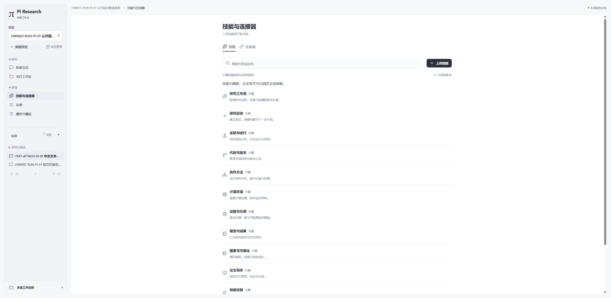

# 当前 Chrome 技能上传、删除与保留

SKILL-UPLOAD-UI-01；基线 `ecb98c4369e6ee8822b6503e072ec78ccfee9073`。只补当前技能库的公开SKILL.md上传与准确修订删除，复用已验的版本升级/回滚、撤销、固定绑定和重试边界。没有产品代码修改，也没有启动新模型、Run或解析任务。

| 验收 | 实际结果 |
|---|---|
| Chrome上传 | 文件选择器上传464字节公开SKILL.md；名称/说明从frontmatter正确填入，“上传并开启”成功，目录由13变14个版本。唯一自定义修订 `fe9edb7b-f421-40ba-878b-7c34bf4a3e78` 自动开启，工具/后端/数据要求均为空 |
| 原文与重开 | 详情显示完整中文/Unicode原文、准确revision/tag和摘要；刷新后同一修订仍开启，原文与输入字节相同。没有会话绑定这份新技能包 |
| 当次确认与删除 | 用户明确允许删除该唯一测试修订后，Chrome只点击一次准确删除按钮。成功提示“历史原文与已固定会话保留”，目录恢复13个内置版本；刷新后目标仍消失 |
| 历史与数据保留 | 当前配置v1→v2且回到原内置bundle。删除标记只指向该修订；原revision、review、旧bundle及464字节原文保持，owner只读inspect/read仍返回原内容。旧330业务记录、28文件及全部既有模型/默认不变，最终335记录 |

测试名称 `uiqa-browser-skill-20261013`；tag `upload-ad5c45f7-c015-4f6e-9bdf-9d54662dac2f`。修订内容摘要 `960f79f8c521873b67e33b797cc61dbb51a05626c05538729b0f6248e9301c5a`；SKILL.md原件SHA256 `6ca5f870bb82357b7216622dc0389b84704a6bf8929cd37bb711ca9cd2be8b33`。删除记录保留而非清空原件；产品没有恢复并再次启用该修订的入口，因此在点击前取得了用户当次确认。未通过CLI/API代做删除。

新增记录仅为一份revision、review、bundle、configuration、deletion；既有会话固定包不变，没有新模型账目、Worker或运行记录。应用仍为61937/PID34248。三组相关机器核对通过；六项实现/构建文件与运行副本内容一致，相关实现及三份技能管理测试自已验阶段未变。全量1938项（1913通过、0失败、25跳过）及661份干净构建沿用既有证据，没有重跑；独立关键复核与冻结哈希见同名evidence JSON。

本次删除的是未绑定会话的单个测试修订。已绑定会话、历史任务及重试保留复用[技能固定版本批次](2026-10-13-skill-fixed-revisions.md)与未变合同检查；未新建会话执行该技能，也未重新覆盖ZIP/资源边界或实际调用已删除版本的启用接口。读取删除后的原文使用owner只读接口，不冒称管理列表仍提供入口。

本轮还收束了固定解析附件的入口预检：App虽保留发送准确doc/parse对的方法，但当前三个LiteratureView父调用分别为只读历史、归档历史或缺少会话/回调的设置页，均不能启用“带入当前会话”。相关接线与既有DOC-VISION观察时未变，因此不重复点击或解析；这是仍待处理的UI入口缺口，sessions/attachments保持partial，不能用TXT/MD或页图读取代替。按用户要求，非阻断项集中待办，本批未恢复旧写入入口或调整布局。

公开QA原始材料保留在 `.validation/skill-upload-ui-20261013/`，入口预检在 `.validation/parsed-attachment-entry-ui-20261013/preflight.md`；不提交数据库、原生会话或凭据。

