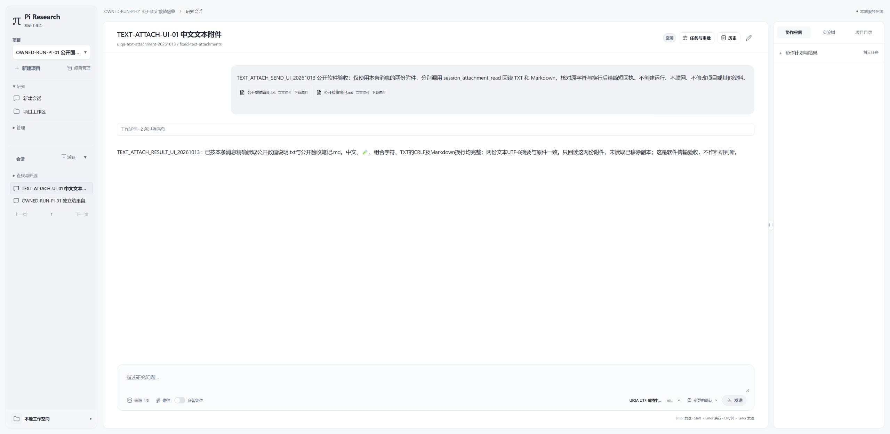

# TXT 与 Markdown 附件的当前 Chrome 流程

TEXT-ATTACH-UI-01；基线 `4ed0ff0960fcecff0d982a76b6bc701ae58afd80`。在原公开数值QA项目中新建独立主会话，经当前Chrome文件选择器上传、移除草稿引用、发送、刷新重开和下载；会话与专用localhost模型由owner API预先准备。本批没有产品代码修改，没有重复已通过的媒体、大小或数量矩阵。

| 验收 | 实际结果 |
|---|---|
| 文本上传 | 三份公开无BOM UTF-8样本成功保存；TXT为182字节、Markdown为192字节，另有100字节移除样本。UI标为“项目资料 · 文本原件” |
| 移除与准确读取 | Chrome移除第三份草稿引用后，项目三份原件/业务记录仍原样保留。发送消息 `71e028e4…` 只绑定前两份；真实Pi顺序调用两次 `session_attachment_read`，准确messageId、documentVersionId、artifactId及tool call ID均匹配 |
| Unicode与传输 | 正文没有自动混进首请求；实际工具回执保留中文、Emoji、NFC/NFD原序列、TXT的CRLF、Markdown的LF和末尾换行。两份文本重新编码的SHA与原件一致，UTF-16游标完整；移除样本正文未进入任何模型请求 |
| 重开与下载 | Chrome刷新重开后附件及回执保留，原native文件摘要不变；点击两个原件下载，各产生一份新文件，大小/字节/SHA与上传原件一致。没有补发模型消息或重复下载 |

本机固定提供方共3次HTTP，全部成功；由真实Pi/Worker读取两份文本后回复。固定回执不是外部模型的理解能力或科研结论。TXT/MD不是native媒体块，当前路径是准确消息附件的受控文本读取；无新文档解析、OCR、Run或权限变更。

TXT SHA256为 `a5c8e1e195afb828525a8dba09c31aafa9b65c0cc62e9d2922c5aaa5997869b4`，Markdown为 `9b731f3ebf283e545e1c0a2cf6674ba626fb60035bc04bf6bd58f14058f521ac`。样本没有BOM；现有TextDecoder会去掉文本开头BOM，但不改原件，不能把本次字节相等推广到BOM提取。

原311条业务记录、28固定文件、默认模型与既有模型配置保持；新增受管连接仅使legacy显示序号3→4。最终330条记录，唯一worker准入已释放，应用仍为PID34248。收尾禁用专用提供方；其exec输入通道已关闭，核对PID及命令身份、确认无在途请求后停止该提供方进程，监听消失，3条请求记录已保存。未重启应用或重试旧失败会话。

一次浏览器等待结果的短时超时发生在页面尚未刷新时，后续实际完成状态和DOM已确认；两次下载事件工具超时，但新增实存文件独立核对通过，未算产品下载失败。历史读取期间短暂欢迎页沿用已有非阻断待办，不扩修布局。

主代理5组相关机器核对通过，17项当前源码/构建/相关测试与运行副本一致（规范化LF）；附件合同及相关测试自已验阶段未变。复用1938项阶段全量（1913通过、0失败、25跳过）与661份干净构建，不称本轮重跑。精确消息/跨会话/过期租约/Unicode分页及其他媒体边界复用既有检查。本批只补TXT/MD的Chrome关键路径；独立关键复核及哈希见同名evidence JSON。

原始公开QA材料留在 `.validation/text-attachment-ui-20261013/`，运行数据与原生会话不提交Git。完整功能目标仍有其他部分覆盖和环境未验分支。

