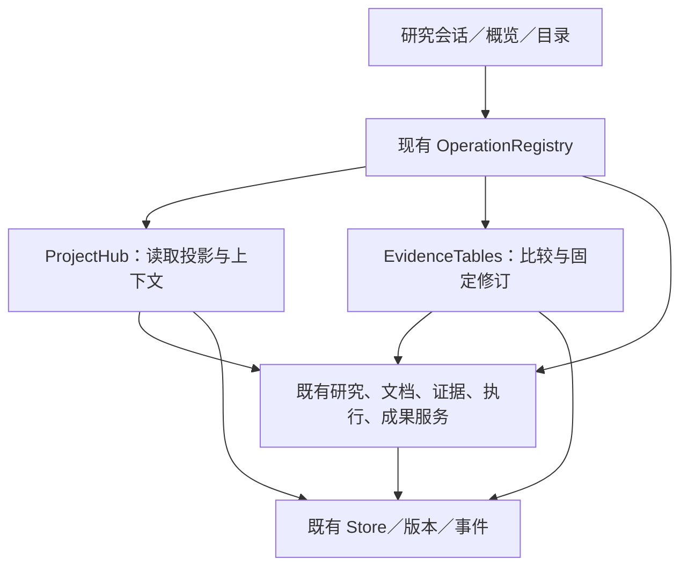

# 研舟π通用科研工作台：详细设计 v1.0

日期：2026-10-21。状态：供用户审阅及后续 Codex 实施的设计；文档完成不代表产品功能已经实现。

配套文件：
- [执行计划](../plans/2026-10-21-general-research-plan.md)
- [Codex 接手入口](../../codex/general-research/START_HERE.md)
- [任务状态](../../codex/general-research/STATE.json)
- [验收与证据](../../codex/general-research/VALIDATION.md)
- [设计决策](../../codex/general-research/DECISIONS.md)
- [当前代码基线](../../codex/general-research/BASELINE.json)

## 1. 目标、范围及事实边界

### 1.1 产品目标

研舟π是通用科研工作台。用户围绕研究问题组织资料、设计工作、获取与比较证据、形成判断、制作成果，并能在后续会话中继续。不同学科共用研究对象、来源、版本和执行基础，方法与工具按任务适配。

本方案面向开发研舟π的 Codex。文档中的 GR/R 编号是开发任务，不是产品里的研究任务，也不是让产品内 Pi 自动开发自身的授权。

目标用户包括个人研究者及在本地工作流中使用工具的研究成员；本版本不扩展多人在线协作平台。文献研究、数据分析、计算与实验、理论方法、定性解释均是合法起点。写作、评价、复现是可独立启动或组合的活动。

### 1.2 本轮及未来执行边界

本轮交付设计、执行计划和接续材料。所有新增产品任务初始为 not_started。后续由用户在 Codex 中发出启动指令后实施；不把“编写方案”记为全部产品实施授权。

根 AGENTS.md 仍然生效。它当前规定前端布局暂缓；本方案允许设计前端入口，但没有修改该约束。START_HERE 中的完整启动提示包含对本方案内必要入口与交互调整的明确授权语句，用户采用该提示后才恢复这些范围。全面视觉重设计、重写布局框架不在本方案范围内。

执行范围内的常规实现、测试、修复和接续可持续推进，不要求每完成一个小步骤重新征求确认。部署、扩大外部数据访问、改变既有权限边界、破坏性数据操作等，按现行授权和具体操作判断，不从本文件自行扩大。

### 1.3 可观察的成功标准

- 用户在同一项目中完成至少三种明显不同的研究旅程，其中至少一种没有代码和 Run。
- 关闭会话并重新打开后，用户能直接找回固定资料、比较结果、决定和成果，并继续未完工作。
- 关键提取值及结论可以回到原材料；来源不足、失效、相互冲突时有明确状态。
- 普通研究用户可以理解计划和确认动作，无须阅读内部 JSON 才能做日常决定。
- 原有会话、实验、固定授权、报告、历史与备份仍可用；新增功能不静默改变旧版本含义。
- 每批验收与交付记录绑定实际代码快照；设计完成、代码完成、验证通过、远端同步分别记录。

### 1.4 明确排除

本期不做完整文献管理器、通用知识图谱平台、学科技能市场、可视化 Agent 编排器、新模型运行时、第二套任务调度器、云实例管理、全套团队权限平台、桌面安装器或自动投稿。RIS/Zotero/Word/Overleaf 深度双向同步列为后续需求触发项。不会用统一的“科学可信度分数”替代证据说明。

## 2. 当前真实基础与接入原则

### 2.1 当前代码基线

核对根目录：`D:\项目\pi research\pi-research`。HEAD 为 `388110292f046e5f2fc7f9e52879867495df64b5`，分支为 `implementation/pr01-reproducible-baseline`。2026-10-21 12:08 UTC 的普通 porcelain 清单有 321 条；这不是按所有未跟踪文件展开后的数量。工作树存在大量既有修改，因此 HEAD 不能单独代表实际源码。精确核对文件及 SHA-256 在 BASELINE.json。

技术基础为 TypeScript、Node.js、React、SQLite 和现有 Pi 运行时；开发复现版本见 package.json、锁文件及 .node-version。当前核实 Node 24.19.0、npm 声明 11.17.0、TypeScript 5.8.3、React 19.3.0、Pi SDK 0.87.1。本设计不要求升级这些依赖。

| 已有能力 | 当前接入位置（相对仓库根） | 设计处理 |
|---|---|---|
| 会话主入口及既有工具区 | apps/web/src/app.tsx、workbench.tsx、conversation-panel-layout.tsx | 在现有容器增加稳定入口，不恢复分散的业务页面 |
| 通用研究简报及确认 | packages/research-workflows/briefs.ts；ResearchBriefService.save/inspect/confirm/capture/assertReference/assertAdmission | 复用计划与固定引用；新方法选择通过独立绑定扩展 |
| 研究活动、计算、审查 | research-workflows、execution、development、runners | 保留原业务服务；新增进展层只做读取和导航 |
| 持续执行与接续 | packages/policy/research-automation.ts、research-handoff.ts | 展示真实状态与能力，不另建持续运行循环 |
| Evidence、Claim 与失效判断 | packages/evidence；packages/domain/types.ts | 在原证据上增加关系与比较，不另造事实库 |
| 文档、文稿、报告及成果包 | packages/documents、publications；apps/web/src/report-view.tsx | 复用固定预览、构建和导出；新增表格快照按来源接入 |
| 操作输入输出、权限与幂等 | packages/contracts/operations/registry.ts、inputs.ts、outputs.ts | 新操作沿同一注册与校验链 |
| 存储、备份、生命周期 | packages/storage/store.ts、backup.ts；packages/policy/lifecycle.ts | 增量记录和索引；明确备份、恢复、归档、删除行为 |

README 含不同时间的阶段说明。出现冲突时以当前源码及实际验证为准，并将发现写入交接；不得根据旧文档重新添加已经实现的自主接续等能力。

### 2.2 不变量

INV-01：产品内 Pi 仍是唯一 Agent 执行内核；开发 Codex 与 Pi 的身份及权限独立。

INV-02：原始材料、固定修订、已冻结报告与历史证据保持原字节；新信息产生新修订或新关联。

INV-03：用户可浏览一个项目，不等于任意 Agent 可读取整个项目。目录可见、正文可读、工具可执行、结论可采纳是不同权限。

INV-04：新增摘要、目录、比较表不授予运行、网络、文件写入、源码整合、发布或科学结论采纳权限。

INV-05：旧 ResearchBrief 的摘要计算与固定引用保持兼容；不能给旧对象补默认字段后重算旧 digest。

INV-06：执行成功、科学判断、审查范围分别表达。负结果、反例、证据不足都可以是有效研究交付。

INV-07：暂停、取消、恢复由现有执行对象决定。未知副作用保持 unknown/待核对，不能为了统一界面伪装成失败或已停止。

INV-08：新增记录必须有项目归属、生命周期校验、版本冲突处理、幂等规则及历史保留规则。

INV-09：失效的历史可按现行权限回看；新分析、采纳、报告或导出重新核验，不静默替换为最新来源。

INV-10：新增页面按需请求有界数据，不能继续把全量新历史塞进 /state。

## 3. 用户流程与信息结构

### 3.1 三个稳定工作面

1. 研究会话：提出问题、调整任务、接收解释、处理当前决定。
2. 项目概览：当前研究方向、进行中的工作、待决定事项、最近成果及需要复查的来源。
3. 资料与成果：可搜索、可过滤、可直接打开的项目对象目录。

项目工作区、实验树、协作空间及高级设置保留。它们在与任务有关时突出显示；用户可以固定常用入口。第一版在现有会话容器/工具区加入“概览”和“资料与成果”，沿用现有布局能力；不要求重写整页。

### 3.2 核心旅程

J1 文献综合：提出问题 → 确认范围 → 选定材料 → 比较表 → 核对单元格来源 → 处理分歧 → 保存结论草稿/报告。

J2 数据分析：说明问题与数据 → 确认分析计划 → 使用现有执行能力分析 → 回查原始数据与方法 → 形成有边界的解释 → 保存成果。

J3 理论/解释研究：说明定义或材料 → 整理推导/编码/解释 → 保存假设与反例 → 记录判断及未解问题 → 输出笔记或报告。该旅程允许没有实验 ID、数值主指标或 Run。

J4 长期接续：重开项目 → 看概览 → 找到固定对象 → 查看上次决定和当前阻塞 → 选择继续 → 只在实际授权范围内推进。

J5 旧项目：打开已有会话/实验/文献/报告 → 原功能正常 → 目录直接发现已存在对象 → 用户可选补充新的项目上下文。

### 3.3 用户用语

上层使用“研究问题与计划”；原 Campaign 按内容展示为“实验迭代”或“计算对照活动”。内部对象名不必迁移。

“已保存”表示写入成功；“工作已完成”表示约定产物齐备；“已采纳”表示用户作出判断；“已核对来源”只代表明确的核对范围；“可复现”必须有相应环境、输入及执行证据。

空项目提供“提出研究问题、导入已有材料、继续已有成果”三个通用起点。实验和多智能体不是新项目必选项。

## 4. 功能需求

### F01 资料与成果目录

自动发现当前项目中已存在的文档、证据、结论、产物、文稿和报告。首批只接入 document、artifact、report 三类；后续按任务增加 adapter。自动发现不复制原始正文。

adapter 交付归属固定：GR01接入document/artifact/report，GR02接入brief/run，GR03接入project-decision，GR05接入comparison-table，GR07接入evidence/claim，GR09接入manuscript。类别尚未交付时不显示伪可用过滤项。

支持类型过滤、名称搜索、按最近更新排序、用户收藏、来源状态及“回到产生它的会话”。第一版沿用原对象标题；改名继续走原对象允许的编辑路径，不新增目录别名写入机制。收藏按项目保存，第一版不做跨项目共享。按访问时间排序与目录别名留待实际需求触发，避免首批增加一套未定义的读取侧写入。

点击对象走已有预览及授权路径。目录返回的是定位信息，不是正文访问凭证。缺失、失效、归档、无访问权限分别显示；列表不能泄漏无权对象的标题、摘要或数量。

### F02 项目概览与进展

显示：用户已采纳的当前方向、真实活动摘要、待决定事项、最近成果、需核查来源。未建立项目上下文的旧项目，显示可用计划候选并标注“尚未选定当前方向”，不能自动把最近一条模型文本当作用户目标。

进展来自现有记录及事件。分别保留 operationStatus、researchOutcome、reviewStatus 三类含义。未知总工作量不显示虚假的百分比。阶段里程碑可显示已完成/总数，但不能把完成率解释为科学正确率。

同一批准或任务在多个组件中出现时，根据实际实体键去重；一项事实只计算一次。等待项说明原因和用户可做的具体动作。暂停整个研究与取消一个计算作业分开提供能力，点击后的反馈按真实对象状态显示。

### F03 项目上下文与决定记录

项目上下文是用户可查看的研究接续材料，包含选定的固定简报、术语约定、范围说明、已采纳决定和未解问题。它不是隐藏记忆，也不是新的权限容器。

会话仍可以有各自的 ResearchBrief；一个项目可保留多个研究分支。用户可选择当前主要方向及辅助方向，不要求把所有会话合并成一份计划。变更当前方向产生新的上下文修订，旧引用保留。

决定记录区分模型提议与用户采纳。记录问题、选择、理由、证据、局限和后续事项。实验 Campaign 的既有决定通过 adapter 展示；新增项目决定用于范围、术语、路线等未被现有 Campaign 决定表达的事项。

“基于此继续”先选择具体会话或新建会话，再显示将绑定的上下文修订和可读来源。上下文有引用不代表正文已授权；需要的材料沿现有授权工具处理。

### F04 研究工作类型与方法覆盖

workTypes 为可组合标签：literature、data-analysis、experimental、theoretical、qualitative。写作和审查作为活动，不额外锁定项目类型。

depth 为 exploratory、documented、protocol-led：分别提供轻量探索、过程留痕、按固定方案推进的默认建议。用户可以调整；选择 protocol-led 只启用可用的流程约束，不自动宣称符合任何学科规范。

方法目录逐项显示 coverage：assistive、structured、machine-checkable，并列出已经实际实现的检查。不得把一项数值方法的机器检查覆盖扩展解释为所有方法都可自动验证。

工作类型影响建议字段、资源读取和验收提示，不影响操作权限。普通问答不强制生成研究计划，不强制读取全部方法资源。

### F05 比较表

用户定义问题、行和列。行的单位可以是论文报告、研究、数据集、案例或观测；论文篇数不自动等于独立研究数量。未知研究映射保留 unknown。

列支持 text、number、category、boolean。首版不执行任意公式。数字保留原始值、单位和条件，规范化值另存并记录规则；单位或条件不一致时不自动排序为优劣结论。

单元格保留值/状态、说明、来源、提取方式与核对状态。缺失状态为 not-reported、not-read、ambiguous、not-applicable、conflicting，不能统一成 null/0/否。

用户可以逐单元格核对、修订、标记争议；原内容和来源保留。修改列定义会使既有单元格出现“列定义已变，待复核”，不能静默把旧答案用于新问题。

### F06 Agent 辅助提取

在手工比较流程可用后接入 Agent。先预览材料范围及列定义，用 2–5 个样本试提取，再由用户决定是否扩展到其选定材料。样本数可更改；产品不硬编码为科学统计样本量。

任务使用既有会话/任务体系及资料授权。模型提交的是候选单元格；服务端校验来源归属、定位、数据类型和当前有效性，不能把模型自报“已核实”直接记成 verified。

长批次拆为固定小分片：每片同一行、同一来源范围、最多5个选定单元格，对应一个现有Task。完成一片提交一次最终结果；恢复只继续未完成片。首版保证已提交分片与其中的候选不丢，崩溃前尚未提交的内容可重新计算；不承诺每个生成中的单元格已落盘。候选去重基于 binding/chunk、目标格、固定来源及内容摘要；不同结果追加待核对版本，不覆盖旧候选。来源或列定义变化必须新建范围，不能复用旧结果冒充新完成。

自动批量提取依赖现有团队任务开关。关闭后保留资料浏览、手工表格、候选核对、导出及原主会话范围内的文本辅助，不能暗中建队或开启多智能体。已有工作按原draining行为停止新派发、保留结果；不宣称所有运行Attempt立即终止。prepare超过现有maxTasksPerTeam或预算时，要求明确缩小批次或调整既有允许配置，不自动扩展队列。

提取本身不自动接受 Claim、触发正式 Run、扩大文献访问或产生已审阅报告。

### F07 证据关系与矩阵

复用既有 Evidence 和 Claim，新增关系 support、contradict、background、method、qualify。每条关系有理由、适用条件、作者来源和固定依据。

多个相反关系可以并存；不按数量投票决定结论。矩阵展示支持、反证、条件、缺口及来源状态。其检索和视图不授予新的全文访问。

矩阵内的采纳按钮仍走既有 Claim 决策链。比较表、关系标签、模型复核不能绕过原结论接受条件。定性、理论等领域尚未实现对应自动验证时，显示具体覆盖，不伪造可验证状态。

### F08 行动摘要与连续工作控制

沿用已有权限模式与自主执行机制。需要决策的卡默认显示：做什么、原因、固定输入、影响范围、预计产物、可选预算及停止条件；精确操作、参数和差异可展开。

摘要由经校验的结构化输入生成；可选的模型说明不能覆盖真实操作字段。若摘要无法可靠生成，清楚显示准确操作，不编造资源估计。

任务控制使用 capability 描述 pause/resume/cancel/inspect，不为所有对象提供同一组虚假按钮。现有完全访问与项目级多智能体设置保持实际作用范围，不增加一排重叠总开关。

### F09 成果修改、复用与交付

首版支持 Markdown 研究笔记和比较表的局部修改，复用现有工作区/产物能力；不建设大型富文本编辑器。对固定报告进行修改时创建新草稿，不能原位修改已冻结报告。

操作明确目标对象与版本。两个窗口同时编辑时返回冲突并保留本地草稿，可手动合并或另存；不得最后写入静默覆盖。

报告纳入比较表或证据矩阵时冻结所选修订及引用快照。后续单元格编辑不改变旧报告；来源失效会影响新构建或新导出，但不销毁既有历史字节。

输出优先支持选定表格/笔记的 JSON、CSV、Markdown，以及已有报告包。JSON 是信息完整格式；CSV/Markdown 通过附带清单保留无法直接表达的状态和引用。首版不做任意第三方文件的无损往返导入。

## 5. 增量架构



### 5.1 新增模块的边界

| planned 路径 | 单一职责 |
|---|---|
| packages/project-hub/types.ts | 目录、概览、上下文的 DTO 与引用类型 |
| packages/project-hub/catalog.ts | 有界目录查询、过滤、排序和 cursor |
| packages/project-hub/adapters.ts | 将既有对象映射为目录元数据；调用原访问检查 |
| packages/project-hub/overview.ts | 由既有任务和批准生成概览；不改变任务状态 |
| packages/project-hub/context.ts | 项目上下文修订、确认和显式会话绑定 |
| packages/project-hub/decisions.ts | 项目决定提议/采纳/取代及历史 |
| packages/research-workflows/work-profiles.ts | 工作类型、深度、方法覆盖及简报绑定 |
| packages/evidence-tables/types.ts、service.ts | 表格、列、行、单元格及修改冲突规则 |
| packages/evidence-tables/revisions.ts | 冻结快照、来源核验、历史修订 |
| packages/evidence-tables/extraction.ts | 候选提取接入和恢复去重；复用现有任务执行 |
| packages/evidence/relations.ts | Evidence–Claim 关系与矩阵投影 |
| packages/publications/research-table-export.ts | 新表格/矩阵快照接入既有成果导出 |
| packages/contracts/operations/project-hub-schemas.ts | Hub 操作输入输出 schema |
| packages/contracts/operations/evidence-table-schemas.ts | 比较表及关系操作 schema |

这些路径是设计目标，不是当前已有文件。实施前查同名能力；若现有文件已实现等价职责，复用并修订文件映射，不重复创建。

只在 ResearchApp 中接线本期新增服务；公共项目、存储和权限接口维持现状。避免为本方案重构整个应用组合根。

### 5.2 目录与固定来源的两种引用

```ts
type CatalogKind = 'document' | 'artifact' | 'evidence' | 'claim' |
  'brief' | 'manuscript' | 'report' | 'run' | 'comparison-table' | 'project-decision';
interface CatalogRef { kind: CatalogKind; id: string }
interface CatalogItem {
  ref: CatalogRef; title: string; updatedAt: string;
  sourceStatus: 'current' | 'stale' | 'unavailable' | 'unknown';
  originSessionId?: string; description?: string; pinned: boolean;
  open: { view: string; targetId: string }; // 导航定位，不能当作授权令牌
}
interface Page<T> { items: T[]; nextCursor: string | null; hasMore: boolean }
```

CatalogRef 仅用于定位。科学引用、计划确认和导出必须使用原领域的固定引用：DocumentVersion/解析结果、Artifact digest、ResearchBriefRef、固定文稿修订、Run manifest 等。不能把 Row.version 当作所有对象都具备的不可变内容版本。

新增 freezeSourceBinding(actor, projectId, ref) 的实现职责由各 adapter 承担：调用原服务核对归属、读权限、固定内容和有效性，再返回本类型的固定引用。首版比较表只接受既有 Evidence 引用及确实归档的用户提供材料；不自行构建可绕过源检查的万能引用。

### 5.3 目录查询契约

默认 pageSize=30，允许 1–100；关键词最长 200 字符；按 updatedAt 降序，再按 kind、id 保证确定顺序。cursor 绑定 projectId、过滤参数、排序及读取身份范围摘要，参数变化拒绝继续旧页。cursor 不是权限凭据，每页重新校验。

返回 hasMore，不为了显示精确总数扫描全部历史。查询在存储层过滤分页，不将 Store.list 的全量结果先发送到浏览器再截断。首版使用现有 records 项目索引及必要的增量索引，不引入向量数据库。

面对持续更新的列表，采用文档化的 live-keyset 语义：当前分页返回已验证对象；刷新后重置分页定位；不声称跨多次请求获得事务级历史快照。客户端按实体键去重，新版本提示刷新，不静默显示过期内容为当前。

## 6. 新增数据与状态契约

### 6.1 项目上下文

使用新记录 kind，内容修订保持不可变：project-research-context、project-research-context-head、project-decision、catalog-preference。头指针更新有 expectedVersion；内容修改生成新 ID 和 digest。

同一个 head 分别保存 latestProposalRevisionId 和 adoptedRevisionId。propose 只推进提议指针；adopt 才推进采纳指针。新草稿不能覆盖已采纳上下文；概览和默认接续始终读取 adoptedRevisionId，草稿另行显示。首次尚未采纳时 adoptedRevisionId=null，不推断用户已同意。

ProjectResearchContext 内容：schemaVersion=1、projectId、previousRevisionId、activeBriefRefs（固定 briefId/digest，最多 20 个，至多一个 primary）、scopeNote、terms、openQuestions、adoptedDecisionRefs、createdBy、createdAt、digest。第一版 terms/openQuestions 各最多 100 项、单项最多 2,000 字符；超限要求分批或外置材料，不能静默截断。

以上是完整读取模型。实际记录沿用 Store Row 的 id/projectId/version/createdAt 等公共元数据，payload 不重复保存第二份可冲突的项目归属与时间。digest 只计算约定的规范化内容及固定引用，不把 mutable head 或 Row.version 算入内容摘要。

上下文的科学内容来自明确引用或用户输入。未选定 brief 时允许草稿上下文，不能标为已确认研究计划。首版由用户保存提议；模型的会话建议可由用户明确保存，不自动成为持久上下文。用户采纳后更新采纳指针。直接Agent上下文写工具不列本期必达范围；以后接入须完成同等来源与权限测试。旧来源失效时头指针不自动指向“最近有效”的其他修订。

ProjectDecision 内容：kind（scope/method/definition/direction/interpretation/next-action）、question、choice、rationale、limitations、fixedEvidenceRefs、followUps、supersedesId、createdBy。状态 proposal/adopted/superseded/withdrawn 的变化保留事件；修改科学内容必须新修订。它不替代 Claim 的科学接受规则，也不替代 Campaign 的执行决定。

会话绑定保存 sessionId、contextRevisionId、contextDigest、boundBy、boundAt。已有会话不被静默换绑，模型运行中沿现有会话状态约束拒绝冲突操作。

### 6.2 方法选择

ResearchWorkProfileSelection 独立保存 briefId、briefDigest、workTypes、depth、selectedMethods（方法 ID、固定版本、覆盖描述）、version=1。新增绑定属于新计划的显式选择，不参与历史 brief digest 的重算。

后续若确需把 profile 直接纳入 brief 内容，必须新增明确 schemaVersion 的创建/计算路径与旧版本兼容分支；不能在此阶段顺手迁移所有旧简报。

### 6.3 比较表

```ts
type CellStatus = 'value' | 'not-reported' | 'not-read' |
  'ambiguous' | 'not-applicable' | 'conflicting';
type CellReview = 'unreviewed' | 'verified' | 'disputed';
interface ComparisonColumn {
  id: string; revisionId: string; title: string;
  question: string; valueType: 'text' | 'number' | 'category' | 'boolean';
  allowedValues?: string[]; expectedUnit?: string;
}
interface ComparisonCellDraft {
  rowId: string; columnRevisionId: string; status: CellStatus;
  value?: string | number | boolean; rawText?: string;
  unit?: string; conditions?: string; explanation: string;
  evidenceIds: string[];
  contentLevel: 'metadata' | 'abstract' | 'full-text' | 'table' | 'figure' | 'user-supplied';
  origin: 'user' | 'agent' | 'import';
}
interface ComparisonCellWrite {
  draft: ComparisonCellDraft;
  expectedCellHeadVersion: number | null; // null仅表示首次创建，已有头时拒绝
}
type ResearchSnapshotRef = {
  kind: 'comparison-table' | 'evidence-matrix'; id: string; digest: string;
};
```

review 不属于 Agent 可任意设置的候选输入。verified 由明确核对操作产生，记录核对主体、时间、来源及列修订；它表示该单元格的核对，不推导为整项研究可信。

持久记录：comparison-table、comparison-table-revision、comparison-column-revision、comparison-row、comparison-cell-revision、comparison-cell-head、comparison-table-snapshot。选择这些新 kind 前，实施者核对已有同义记录，避免重复。

table 保存当前结构修订引用和结构版本；结构修订固定列顺序、列修订、行单位及行定义。structureUpdate 使用 expectedVersion，支持改标题、增加/重排/停用行列。行列 ID 稳定，修改定义产生新修订；停用只影响当前视图，不删除单元格历史或固定快照。rowVersion 专指行定义版本，单元格修改不悄悄改变行单位。列定义变化后，旧单元格仍保留原 columnRevisionId，并标待复核。

首版每表最多 500 行、30 列；一次 upsert 最多 50 个单元格，输入 UTF-8 总量最多 512 KiB；单元格 explanation 最多 4,000 字符，value/rawText 各最多 12,000 字符；每格 evidenceIds 最多 20 个。读取按行分页，默认 30、最多 100。边界是产品实现上限，不是科学样本量限制；超限显式报错，不截断。

每次保存使用 tableVersion 及相关 cellHeadVersion 检查并发。相同幂等键和相同输入返回原回执；相同键不同输入冲突。单批写入和事件在同一事务完成。

tableVersion 是当前表头的 CAS 版本；tableRevisionId 是不可变的结构修订。它们不能互换。正常单元格写入不改变结构修订；冻结快照同时捕获行定义实际内容、列修订、单元格修订和固定来源，不能仅引用可变 row 对象。

固定快照包含实际列修订、行单位、所选单元格修订及固定证据引用，生成内容摘要。snapshot 不自动等于报告；导出继续走既有来源核验与产物限制。

freeze 可选择 selectedRowIds/selectedColumnRevisionIds，省略时固定当前表的全部活动范围。服务校验均属同表、列修订仍匹配、选择无重复且满足行列上限；冻结实际子集与当时的单元格修订。导出只消费此快照，不在导出时临时裁切活表或用新列替换旧列。inspect 的 target 为闭合联合 `{kind:'current'}` 或 `{kind:'snapshot',snapshotRef}`；snapshot读取固定内容，不落到当前cell heads。

### 6.4 证据关系

EvidenceRelation：claimId、claimStatementDigest、evidenceId、evidenceBindingDigest、relation、rationale、conditions、createdBy、previousRevisionId。关系内容不可变，撤回另记状态。Claim 科学内容更新后，旧关系保留并标需复核，不能自动附着到修改后的主张。

新增 evidence-matrix-snapshot：固定单个Claim的科学内容及摘要、用户选定最多500条relation修订、当时关系状态、各条固定Evidence引用和快照digest。freezeMatrix 在同一读取快照内核对 expectedClaimVersion 与关系归属，范围过大明确要求缩小，不截断。后续改Claim、撤回关系或来源失效不改历史字节；新导出与报告仍重验有效性。matrix inspect区分current和snapshotRef；GR09导出与报告通过ResearchSnapshotRef判别处理两类快照。

### 6.5 任务摘要 DTO

ResearchProgressItem：sourceRef、label、operationStatus、researchOutcome、reviewStatus、reason、nextAction、capabilities、updatedAt。三类状态均允许 unknown/not-applicable，不能因缺少字段推断为成功。

capabilities 每项携带现有领域动作、目标 ID 和所需版本；只提供真实支持的动作。新增 Hub 不直接更新 run/campaign/continuation 的 state。

### 6.6 提取任务的准确绑定

GR06 新增专用 EvidenceTableExtractionBinding，复用 TeamService 的派发、审批、租约、重试和结果。记录 kind 为 evidence-table-extraction-binding，内容不可变；不建设通用 grant 系统。

绑定内容为 schemaVersion、id/digest、rootSessionId、tableId、tableRevisionId、rowScopes、columnRevisionIds、sourceScopes、chunks、modelDigest、permission、lifecycleEpoch。其中 rowScopes 是逐行的 `{rowId,rowVersion,allowedColumnRevisionIds,sourceScopeIds}`，不能把所有行与所有列默认作笛卡尔积授权。

chunks 由宿主根据每行的来源范围确定性划分：`{chunkId,rowId,rowVersion,columnRevisionIds,sourceScopeIds}`，每片只含一行且同一来源集合，最多5个单元格。相同一行若需要不同来源集合，拆成不同片。Task绑定唯一chunkId；普通artifact/evidence读取无需信任模型提供rowId，就能从当前Task得到唯一允许范围。提交时再逐格验证目标列及引用。限制提取范围为单个绑定内可被现有团队任务上限和预算容纳的片数。

sourceScopes 只接受两类固定引用：已存在 Evidence 的 evidenceId/digest/artifactId，或 DocumentVersion 的 documentVersionId/documentDigest/parseResultId/parseDigest/allowedPageNumbers/existingAccessRef。引用均由宿主按原授权验证器冻结；Binding 本身不授予任何原文读取权。来源授权不能覆盖目标任务会话时，任务显示 blocked；不得把 owner 可读的全文复制进上下文绕过授权。

prepare 产生范围预览并进入现有团队审批链。宿主专用创建路径为 Task 写入 evidenceTableExtractionId/extractionChunkId，不向通用 TaskSpec 或 agent_delegate 开放这些字段。team-plan/planDigest 纳入 Binding digest与分片映射；扩大材料或列范围必须新建 Binding 并重新审批。TaskAttempt 固定 `{id,digest,chunkId}`，claim 把该片允许行列定义及来源引用纳入 inputs.evidenceTableExtraction 和已有 inputDigest，不注入未经授权的正文。

在 ResearchApp 给 TeamService 接入专用 extractionValidator，覆盖 claim/active/assertRetry/submit。每次提取读写调用核对当前 actor、Task、TaskAttempt、team、generation/lease、plan/directive version、context-snapshot/inputDigest、模型、权限与项目生命周期，以及表结构、行和列修订。只使用服务端身份；输入不接受调用者自选 taskId/attemptId/generation/permission。

提取只返回候选 TaskResult，带 bindingRef/chunkId、宿主 taskId/attemptId/inputDigest、目标行列、值、来源及局限。现有TeamService.submit的completed/partial/blocked都会终结本Attempt；因此一个片每Attempt只提交一次，不每填一格调用最终submit。packages/collaboration/results.ts与TeamService的专用验证/提交接点，在同一事务保存不可变 evidence-table-candidate 记录和最终TaskResult。候选固定来源TaskResult；相同内容去重，不同内容追加独立候选。

任务 Agent 不能调用正式 cells_upsert 或 review。owner 使用 applyCandidates，重新验证来源与目标版本，再以 tableVersion及每格expectedCellHeadVersion CAS 写入未核对单元格；已有头要求准确version，首次写为null。候选不会自动成为 verified 或被接受的 Claim。

所有直接和间接读取均取既有权限与 sourceScope 的交集，包括 artifact_read、evidence_read、text_evidence_search、task_result_read 及上下游结果；标题、摘要、引用、快照及旧幂等回执同样适用。fullAccess 不免除这些业务边界；SessionPermissionService 的 READ 早返回不能代替本层校验。

retry 只沿用原 Binding/chunk；新 attempt 获得新 generation，不吸收后来新增的资料或列。已提交片和partial中的候选从独立候选记录及历史TaskResult恢复，不依赖retry会清空的Task.result；新尝试可引用合法原候选，只补未完成格。partial后的继续必须由现有显式retry及状态约束准入，不因Task为blocked就自动重派。范围失效阻塞重试；旧 attempt 不能创建新候选。permission-action 的 fingerprint 纳入 Binding/chunk与版本，只给合法提取任务开放对应副作用，不将 submit 无条件加入所有任务的副作用白名单。运行中逐格checkpoint后置，本期不同时建设第二套保存协议。

最终submit成功后，相同请求的只读幂等回执沿现有TaskResult重放规则处理：必须是原宿主身份、原Binding/chunk和相同输入摘要，并重新核对当前可见性；不能要求已finished的Attempt重新变running，也不能允许重放写入新候选。新Attempt、不同输入或撤权后的读取不借旧回执扩大权限。

## 7. 操作接口及权限

所有下列操作都是 planned。具体注册在现有 OperationRegistry，输入输出均有 schema；HTTP/CLI/Pi 不各自实现业务逻辑。未知输入字段按现有验证策略处理，新增字段的保留或拒绝需要契约测试。

| 操作名 | 核心输入 | 输出 | v1 权限 |
|---|---|---|---|
| project_catalog_list | projectId, types?, query?, cursor?, pageSize? | Page<CatalogItem> | owner；Agent 沿已有受限 history 工具 |
| project_catalog_pin | projectId, ref, pinned, expectedVersion?, requestKey | preference receipt | owner |
| project_overview_inspect | projectId | overview DTO | owner |
| project_context_inspect | projectId, revisionId? | adopted/proposal context refs | owner |
| project_context_propose | projectId, baseRevisionId?, expectedHeadVersion, content, requestKey | draft context ref | owner；Agent 接入须单独完成受限工具测试 |
| project_context_adopt | projectId, revisionId, digest, expectedHeadVersion, requestKey | adopted ref | owner |
| project_context_bind | projectId, sessionId, revisionId, digest, expectedSessionVersion, requestKey | binding receipt | owner |
| project_decision_list | projectId, cursor?, pageSize? | decision page | owner |
| project_decision_propose | projectId, content, requestKey | decision ref | owner；后续受限主协调提议 |
| project_decision_decide | projectId, decisionId, expectedVersion, decision, requestKey | receipt | owner |
| research_work_profile_set | projectId, briefRef, selection, requestKey | profile ref | 依原简报创建/确认边界 |
| research_work_profile_inspect | projectId, briefRef | profile / unset | 依原简报读取边界 |
| comparison_table_create | projectId, title, questionRef?, columns, rows, requestKey | table ref | owner；后续受限主协调 |
| comparison_table_inspect | projectId, tableId, target(current/snapshotRef), cursor?, pageSize? | fixed/current table page | owner；任务Agent走专用分片读取 |
| comparison_table_structure_update | projectId, tableId, expectedVersion, changes, requestKey | structure ref | owner |
| comparison_table_cells_upsert | projectId, tableId, expectedVersion, writes:ComparisonCellWrite[], requestKey | receipt | owner；Agent 仅提交候选 |
| comparison_cell_review | projectId, tableId, cellRevisionId, decision, expectedVersion, requestKey | review receipt | owner |
| comparison_table_freeze | projectId, tableId, expectedVersion, selectedRowIds?, selectedColumnRevisionIds?, requestKey | ResearchSnapshotRef | owner / 沿现有固定产物权限 |
| evidence_table_extraction_prepare | projectId, tableId, rowScopes, sourceRefs, requestKey | binding proposal | owner；协调 Agent 经既有批准路径提议 |
| evidence_table_extraction_inspect | projectId, extractionId | binding/status metadata | owner；任务角色仅准确范围 |
| evidence_table_extraction_read | projectId | current task scoped DTO | 已绑定 literature/analyst TaskAttempt |
| evidence_table_extraction_submit | projectId, items, requestKey | candidate TaskResult | 已绑定 literature/analyst TaskAttempt |
| evidence_table_extraction_apply | projectId, extractionId, candidateWrites(candidateRef/expectedCellHeadVersion), expectedVersion, requestKey | cell receipt | owner |
| evidence_relation_propose | projectId, fixedClaimRef, fixedEvidenceRef, relation, rationale, requestKey | relation ref | owner / 有相同来源范围的提议者 |
| evidence_relation_withdraw | projectId, relationId, expectedVersion, reason, requestKey | withdrawal receipt | owner |
| evidence_matrix_inspect | projectId, claimId, target(current/snapshotRef), cursor?, pageSize? | fixed/current matrix DTO | owner；Agent 按来源过滤 |
| evidence_matrix_freeze | projectId, claimId, expectedClaimVersion, relationRevisionIds, requestKey | ResearchSnapshotRef | owner |
| research_table_export | projectId, snapshotRef:ResearchSnapshotRef, format, requestKey | existing artifact/export receipt | 沿现有导出边界 |

requestKey 是业务幂等标识；如现有 operation envelope 已提供该字段，应从 envelope 传入服务，不在 body 再建第二套键。接口注册阶段统一一次并同步计划与测试。

服务签名固定采用当前工程形式：`service.method(actor: Actor, projectId: string, input: Input): Output`；catalog/overview 方法为 list(actor, projectId, input)、inspect(actor, projectId)。现有 operation context 的项目/会话身份从服务端构造，不能信任模型伪造 actor 或 owner 标记。

新增输入采用闭合 schema；分页及长文本复用第5、6节上限。返回错误沿现有 error envelope，准确区分无权、来源失效、版本冲突、超限、生命周期禁止和不存在；对无权对象避免用差异化错误披露存在性。具体错误常量优先复用现有错误集，GR01 契约测试锁定映射，后续批次沿用。

第一阶段 owner-only Hub 不新增 Agent 全项目检索权限。接入 Agent 提取时必须同时更新：operation 输入输出、角色工具目录、dispatcher 过滤、具体 source/grant 校验及审计。只添加 tool definition 不算接入完成。

审查者保持固定只读范围；不得因可读比较表而读取其所有未授权原文或派生 Run。附属助手不继承主协调会话的全部上下文。无权访问时连同标题、引用列表和计数一并正确过滤。

## 8. 兼容、生命周期和迁移

### 8.1 旧数据

旧项目无需迁移新字段即可打开。目录以既有对象为来源读取；没有新上下文就显示未选定。新功能按需创建记录，避免启动时遍历所有数据重写对象。

存储当前使用通用 records 表，并有 schema_migrations。新增 kind 本身不需要改旧 JSON；所需索引使用新的迁移。迁移编号由执行期读取最大版本后确定，不能在文档里抢占固定编号。

当前 packages/storage/backup.ts 的 stateCheck 只接受 schema 至14。若新增迁移，必须同批更新允许版本及恢复兼容检查，不可只增数据库版本。packages/storage/project-purge.ts 的 databaseShape 对表/trigger 有白名单；新表或trigger需同批接入，优先复用records及索引。references/managedRoots/unknownResources 对文件引用有约束；新增导出使用原受管 artifact 路径，不引入任意路径字段。

### 8.2 备份、恢复、归档与删除

新记录必须保存在正确 project_id 下，以便沿项目生命周期管理；新 artifact/blob 使用现有归档路径。备份包含新记录不代表恢复时引用一定正确，需新增完整性校验：表格头指向存在的修订、上下文引用仍能解析、快照摘要一致。

归档后只读。重新打开项目不会复活旧运行授权。移入回收站、恢复、永久清除沿现有生命周期策略；所有新记录及归属正确的快照随同处理，不能留下跨项目悬空记录。

来源失效同时影响新比较/上下文的可用性投影与新报告构建；历史修订不删除。源文件重解析得到新版本后，由用户选择创建新候选或新表格修订，不自动替换旧 locator。

现有 invalidationClosure/expireDerivations 不会自动理解新的表格或上下文kind。读投影、候选应用、快照冻结、报告构建及新导出均须显式调用原来源核验，并补充新增报告派生关系；不能仅新增一种记录后假设失效链已覆盖。撤销授权后，缓存与 operationResult 回放也先核对当前可见性，不能重新泄露历史引文。

### 8.3 回退

新 UI/工具可通过已有能力目录隐藏，旧流程继续可用。新索引与新增记录一般保留，不在功能回退时删除科研内容。若旧程序无法识别新记录，必须在版本预检明确阻止不安全降级；不默认“老二进制一定能读新库”。

回退产品代码只逆转本批修改，保留原工作树及数据。部署运行环境的回退与源码提交回退分别处理。

## 9. 验证策略与交付边界

每批 3–5 个验收条件，覆盖成功、拒绝/冲突/失效、刷新/重开和适用的历史保留。案例与具体命令见 VALIDATION.md 和执行计划。

定向测试验证源引用、权限、幂等、冲突和状态映射。浏览器验证真实输入、点击、导航、刷新及下载。当前仓库没有已核实的 npm run test:browser；不得把 React stub/字符串断言当真实浏览器通过。

每批集成按根 AGENTS 执行一次必要全量回归、干净构建和独立复核。已经符合当前快照的证据可复用；出现相关代码/环境变化或新反例再补验证。文档本身不运行无关的完整产品测试来制造“已验证实现”。

第一批优先交付“直接找回已有材料和报告”，后续任务未开始时不暴露不可用入口。各功能的完成定义同时包含服务、契约、真实 UI、必要权限与来源校验，不能仅因 API 返回 200 标记完成。

### 9.1 交互和运行质量

新工作面均有loading、empty、error、denied、stale、conflict等适用状态；请求失败保留可识别的旧结果与更新时间。切项目/筛选后丢弃过期请求响应，搜索请求可取消，避免旧项目结果回填新页面。

常用动作可用键盘完成，输入有明确标签，保存/失败/冲突反馈可被辅助技术感知；证据抽屉关闭后焦点回到原单元格。表格采用有界分页，长文本展开阅读，不把全部500×30格全文同时装入DOM。

运行记录沿原事件/诊断系统保存操作ID、目标、耗时、结果状态和来源版本，不额外收集研究正文或秘密。验收关注三项可观察结果：已有对象能直接找回，重开后可继续同一固定版本，关键结论可回到原材料。时延目标先在GR01记录实际参考环境和样本规模，再按发现的瓶颈设定；本设计不虚报尚未测量的性能数字。

## 10. 已知工程风险与按需处理

前次代码评估发现的事项需在 GR00 检查当前是否仍存在：
- R01：Run 启动标记在 control 目录创建或日志打开失败时可能残留。已有隔离故障复现；本轮未修复。
- R02：Worker RPC 固定 30 秒超时与允许更长的宿主命令不一致，可能失去真实结果。当前为代码路径分析；需要定向复现。
- R03：浏览器脚本和 CI 覆盖与当前入口可能脱节。新功能的真实旅程验证不得依赖旧入口假设。

R01/R02 与运行/宿主命令相关，不能阻止只读目录批次先推进；进入依赖这些路径的自动计算流程前必须给出处理或确证不适用的结果。不得把先前技术评估中的测试通过推导成新增功能通过。

## 11. 功能优先级和完成范围

第一可用版本：F01、F02、F03、F04，提供稳定目录、概览、显式上下文与通用研究起点。

证据工作版本：F05、F06、F07，提供可回查比较与分歧整理。

完整交付版本：F08、F09 及三类研究旅程的综合验收，保留既有执行与成果链。

最终收口后只处理本方案遗留阻断；新领域适配、深度同步、团队平台进入新需求，不由 Codex 自动扩展为永久维护任务。

## 12. 设计依据

代码事实：BASELINE.json 列出的当前工作树文件，以及本文件第 2 节映射；不是仅依据旧 README 或 HEAD。

Codex 接续方式参考 OpenAI 官方关于明确目标、分批里程碑、验证和持续状态记录的说明。这里的文件名、任务结构和实施边界为本项目定制，不能据文件存在宣称 Codex 会在无人启动时永久运行。

- https://developers.openai.com/blog/run-long-horizon-tasks-with-codex
- https://developers.openai.com/cookbook/examples/codex/iterating-development-workflows-with-codex
- https://learn.chatgpt.com/docs/agent-configuration/agents-md

文献提取交互参考：自定义提取列及单元格回查原文；不复制某一领域的固定筛选框架作为通用默认。
- https://support.elicit.com/en/articles/14759154-systematic-reviews-in-elicit
